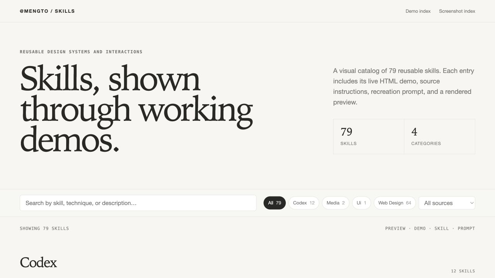

# Agent Skills Vault

Масштабная библиотека переиспользуемых навыков (**271 Agent Skill**) для **Claude Code**, **Cursor**, **Codex**, **Windsurf**, **Antigravity**, **GitHub Copilot** и других AI-агентов.

Собраны топовые мировые решения против шаблонного «пластикового» ИИ-дизайна (**Taste Skill**, **UI/UX Pro Max**, **Impeccable**, **Emil Kowalski Skills**, **Anthropic Frontend Design**, **Claude Design Skill**, **Vercel Web Design Guidelines**), официальный пакет современных веб-стандартов **GoogleChrome Modern Web Guidance** (совместно с Edge, Firefox и MDN), полная коллекция **MengTo/Skills** (все 94 навыка веб-дизайна, 3D и иллюстрации), библиотека **84 файлов `DESIGN.md`** с разобранными дизайн-системами реальных брендов, UX-законы и правила архитектуры сайта, аудит **Lighthouse / Core Web Vitals**, а также паки по геймдеву, Яндекс Играм и прикладной криптографии.



---

## Проекты, собранные на этих навыках

- **[`projects/victoria-falls/`](projects/victoria-falls/README.md)** — биржевой терминал (валюты ЦБ РФ, крипта, акции MOEX, индексы страха/альтсезона, конвертер). Переработан по 10 навыкам волта: oklch-дизайн-система по гибридной ДНК `linear.app` + `stripe` + `mercury`, современный CSS вместо внешних обоев и иконочного шрифта, честная деградация в демо-режим при недоступности API, доступность и разгон Core Web Vitals. Дизайн-правила — в [`DESIGN.md`](projects/victoria-falls/DESIGN.md).

---

## Быстрый рецепт: какую связку выбрать для крутого сайта

| Задача | Какие навыки подключить агенту |
| --- | --- |
| **Дорогой лендинг / промо-сайт без клише ИИ** | [`taste-skill`](agent-skills/ui/taste-skill/SKILL.md) + [`no-ai-design-slop`](agent-skills/ui/no-ai-design-slop/SKILL.md) + любая тема из [`web-design/`](agent-skills/web-design/README.md) |
| **Подобрать палитру, шрифты и стиль под нишу** | [`ui-ux-pro-max`](agent-skills/ui/ui-ux-pro-max/SKILL.md) (79 стилей, 192 палитры, 74 шрифтовые пары) |
| **Сделать отзывчивые микро-анимации как в Linear / Apple** | [`emil-design-eng`](agent-skills/design-engineering/emil-design-eng/SKILL.md) + [`animate`](agent-skills/design-engineering/animate/SKILL.md) + [`choreograph`](agent-skills/design-engineering/choreograph/SKILL.md) |
| **Вычистить и отполировать уже свёрстанный сайт** | [`impeccable`](agent-skills/ui/impeccable/SKILL.md) + [`audit-ai-design-slop`](agent-skills/ui/audit-ai-design-slop/SKILL.md) + [`web-design-guidelines`](agent-skills/vercel/web-design-guidelines/SKILL.md) |
| **Собрать сайт уровня Awwwards со скролл-сценами и 3D** | [`build-awwwards-quality-sites`](agent-skills/web-design/build-awwwards-quality-sites/SKILL.md) + [`cinematic-gsap-lenis-motion-system`](agent-skills/web-design/cinematic-gsap-lenis-motion-system/SKILL.md) |
| **Писать на свежем нативном CSS/HTML без устаревших JS-костылей** | [`modern-web-guidance`](agent-skills/web-platform/modern-web-guidance/SKILL.md) (250 фич современной веб-платформы от Chrome, Edge, Firefox и MDN) |
| **Сделать сайт «как у Stripe / Linear / Vercel», но не копию** | [`design-md-library`](agent-skills/design-logic/design-md-library/SKILL.md) (84 дизайн-ДНК с точными токенами) + [`design-extract`](agent-skills/design-logic/design-extract/SKILL.md) |
| **Продумать структуру сайта, навигацию и сценарии** | [`site-architecture`](agent-skills/design-logic/site-architecture/SKILL.md) + [`information-architecture`](agent-skills/design-logic/information-architecture/SKILL.md) + [`numerique-responsable`](agent-skills/design-logic/numerique-responsable/SKILL.md) |
| **Поднять конверсию лендинга, тарифов и онбординга** | [`cro`](agent-skills/design-logic/cro/SKILL.md) + [`copywriting`](agent-skills/design-logic/copywriting/SKILL.md) + [`onboarding`](agent-skills/design-logic/onboarding/SKILL.md) |
| **Проверить скорость, доступность и SEO перед сдачей** | [`web-quality-audit`](agent-skills/web-quality/web-quality-audit/SKILL.md) + [`core-web-vitals`](agent-skills/web-quality/core-web-vitals/SKILL.md) |

---

## Структура репозитория

```text
agent-skills/
  ui/                  # Дизайн-системы, Taste Skill, UI/UX Pro Max, Impeccable, Anti-Slop (29)
  design-engineering/  # Микро-анимации, жесты, моушн-принципы и полировка UI (20)
  web-design/          # Полная база тем, шейдеров, WebGL и скролл-сторителлинга (94)
  web-platform/        # Современные веб-стандарты и расширения Chrome/Edge/Firefox/MDN (2)
  design-logic/        # Дизайн-ДНК брендов, UX-законы, архитектура сайта и конверсия (15)
  web-quality/         # Lighthouse, Core Web Vitals, доступность и техническое SEO (6)
  vercel/              # Аудит UI, View Transitions и производительность React/Next.js (9)
  3d/                  # Реалистичные PBR-материалы, вода, свет и 3D-туры в Three.js (16)
  illustration/        # Авторские векторные SVG-иллюстрации в 14 стилях (14)
  codex/               # Промпт-инжиниринг, захват референсов, видео-в-суперпромпт (20)
  workflow/            # Циклы скриншот-проверки и доведения качества до 10/10 (4)
  media/               # Аватары, моушн-ролики и стоковые изображения (7)
  game-development/    # Архитектура браузерных и Three.js игр (21)
  game-combat/         # Боевые анимации и стихийные спецэффекты (6)
  security-crypto/     # Прикладная криптография, управление ключами и защита (6)
  YA_SKILLS/           # Аудит модерации и авто-фиксер для Яндекс Игр (2)

projects/
  victoria-falls/      # Биржевой терминал, собранный на этих навыках
```

Правила автоматического применения и жёсткие фронтенд-ограничения (`Anti-Generic Guardrails`) прописаны в [CLAUDE.md](CLAUDE.md). Индекс локальных демо и скриншотов: [DEMOS.md](DEMOS.md), [SCREENSHOTS.md](SCREENSHOTS.md), [SCREENSHOTS.html](SCREENSHOTS.html).

---

## Полный каталог навыков (271)

### 1. UI, дизайн-системы и борьба со стоковым ИИ ([`agent-skills/ui/`](agent-skills/ui/README.md) — 29)

- **[`anthropic-frontend-design`](agent-skills/ui/anthropic-frontend-design/SKILL.md)** — Официальный навык фронтенд-дизайна от Anthropic: уход от нейросетевых клише, продуманная композиция, палитра и типографика.
- **[`antislop`](agent-skills/ui/antislop/SKILL.md)** — Ядро-фильтр anti-slop (miqdadbadjuber, 9.2k★): правила, которые агент держит загруженными постоянно, + полный свод в [`references/antislop.md`](agent-skills/ui/antislop/references/antislop.md).
- **[`antislop-code`](agent-skills/ui/antislop-code/SKILL.md)** — Фильтр сгенерированного кода: структура, именование, дублирование и «код ради кода».
- **[`antislop-copywriting`](agent-skills/ui/antislop-copywriting/SKILL.md)** — Фильтр текстов: маркеры ИИ-письма, пустые обещания, штампы маркетингового языка.
- **[`antislop-human`](agent-skills/ui/antislop-human/SKILL.md)** — Правила живого письма и подачи: ритм, конкретика, отказ от канцелярита.
- **[`antislop-layoutmobile`](agent-skills/ui/antislop-layoutmobile/SKILL.md)** — Слоп в раскладке и мобильной адаптации: сломанные сетки, неучтённые состояния, тач-цели.
- **[`antislop-ui`](agent-skills/ui/antislop-ui/SKILL.md)** — Визуальные правила против типового ИИ-интерфейса: цвет, типографика, глубина, состояния.
- **[`apple-hig-design`](agent-skills/ui/apple-hig-design/SKILL.md)** — Принципы Apple Human Interface Guidelines: vibrancy/blur материалы, squircle-скругления, SF Pro и жесты.
- **[`audit-ai-design-slop`](agent-skills/ui/audit-ai-design-slop/SKILL.md)** — Аудит готовых макетов, скриншотов и кода на предмет нейросетевых клише и визуальных дефектов.
- **[`banner-design`](agent-skills/ui/banner-design/SKILL.md)** — Арт-дирекшн и дизайн баннеров для hero-секций сайтов, соцсетей и рекламных креативов.
- **[`brand`](agent-skills/ui/brand/SKILL.md)** — Голос бренда, визуальная айдентика, управление бренд-ассетами и консистентность коммуникаций.
- **[`brand-guidelines`](agent-skills/ui/brand-guidelines/SKILL.md)** — Применение строгих корпоративных гайдлайнов цвета и типографики к документам и веб-артефактам.
- **[`canvas-design`](agent-skills/ui/canvas-design/SKILL.md)** — Создание плакатной и графической визуальной композиции с выверенной дизайн-философией.
- **[`claude-design-skill`](agent-skills/ui/claude-design-skill/SKILL.md)** — Портативный дизайн-архитектор HTML-артефактов: матрица 10 дизайн-философий × 5 школ, живая панель Tweaks, лендинги, презентации и прототипы.
- **[`design`](agent-skills/ui/design/SKILL.md)** — Комплексный навык айдентики: дизайн-токены, UI-стилизация и генерация логотипов в 55 стилях.
- **[`design-first-ui-prompting`](agent-skills/ui/design-first-ui-prompting/SKILL.md)** — Структурирование UI-промптов в виде чётких дизайн-спецификаций (иерархия, сетка, шрифты, ограничения).
- **[`design-system`](agent-skills/ui/design-system/SKILL.md)** — Трёхслойная архитектура дизайн-токенов (primitive → semantic → component) и спецификации компонентов.
- **[`frontend-design`](agent-skills/ui/frontend-design/SKILL.md)** — Авторский фронтенд-дизайн: выразительные шрифтовые пары, правило цвета 60–30–10, пространственный ритм и тактильные состояния.
- **[`google-material-design-3`](agent-skills/ui/google-material-design-3/SKILL.md)** — Дизайн-система Material Design 3 (Material You): динамический цвет HCT, тональные поверхности и 30+ компонентов.
- **[`impeccable`](agent-skills/ui/impeccable/SKILL.md)** — Система дизайн-критики и финальной полировки (Paul Bakaus, 110k★): 20+ воркфлоу (`critique`, `polish`, `bolder`, `typeset`, `colorize`, `audit`).
- **[`no-ai-design-slop`](agent-skills/ui/no-ai-design-slop/SKILL.md)** — Предотвращение шаблонных ИИ-решений на этапе генерации сайтов, лендингов и приложений.
- **[`refactoring-ui`](agent-skills/ui/refactoring-ui/SKILL.md)** — Практические правила чистого интерфейса (Refactoring UI): иерархия через вес и контраст, многослойные тени, шкала отступов.
- **[`shadcn-ui-design-system`](agent-skills/ui/shadcn-ui-design-system/SKILL.md)** — Архитектура масштабируемых веб-интерфейсов на shadcn/ui + Radix UI + Tailwind CSS и CSS-переменных.
- **[`slides`](agent-skills/ui/slides/SKILL.md)** — Проектирование отзывчивых HTML-презентаций с дизайн-токенами, графиками Chart.js и копирайтинг-формулами.
- **[`taste-skill`](agent-skills/ui/taste-skill/SKILL.md)** — Флагманский anti-slop навык (Leonxlnx, 115k★): крутилки вкуса, жёсткий запрет шаблонов ИИ, готовая библиотека UI/эффектов и браузерная самопроверка.
- **[`theme-factory`](agent-skills/ui/theme-factory/SKILL.md)** — Фабрика визуальных тем (палитры + шрифтовые пары) для мгновенного оформления HTML-лендингов, доков и слайдов.
- **[`ui-styling`](agent-skills/ui/ui-styling/SKILL.md)** — Стилизация доступных интерфейсов на базе shadcn/ui, Radix UI, Tailwind CSS и Canvas-визуализаций.
- **[`ui-ux-pro-max`](agent-skills/ui/ui-ux-pro-max/SKILL.md)** — Поисковый дизайн-движок (NextLevelBuilder, 149k★): 79 UI-стилей, 192 палитры, 74 шрифтовые пары и UX-правила под 22 стека через `scripts/search.py`.
- **[`web-artifacts-builder`](agent-skills/ui/web-artifacts-builder/SKILL.md)** — Сборка сложных многокомпонентных веб-артефактов на React, Tailwind CSS и shadcn/ui.

### 2. Дизайн-инженерия и микро-анимации ([`agent-skills/design-engineering/`](agent-skills/design-engineering/README.md) — 20)

- **[`animate`](agent-skills/design-engineering/animate/SKILL.md)** — Пошаговое создание веб-анимации с нуля: нужно ли анимировать, выбор кривой, длительности и пружинной физики.
- **[`animate-expo`](agent-skills/design-engineering/animate-expo/SKILL.md)** — Построение плавных нативных анимаций в React Native и Expo.
- **[`animation-performance`](agent-skills/design-engineering/animation-performance/SKILL.md)** — Удержание анимаций в бюджете 60/120 FPS: композитные свойства, работа вне главного потока, отказ от layout thrashing.
- **[`animation-vocabulary`](agent-skills/design-engineering/animation-vocabulary/SKILL.md)** — Обратный словарь моушн-эффектов: перевод описания на человеческом языке в точный технический термин и паттерн.
- **[`apple-design`](agent-skills/design-engineering/apple-design/SKILL.md)** — Перенос принципов физического отклика и плавности интерфейсов Apple в веб-разработку.
- **[`ask-sonner`](agent-skills/design-engineering/ask-sonner/SKILL.md)** — Эталонная настройка уведомлений (toasts) на библиотеке Sonner в React.
- **[`break-ui`](agent-skills/design-engineering/break-ui/SKILL.md)** — Стресс-тест вёрстки экстремальными данными: длинные ФИО, неразрывные строки, пустые состояния, 1 символ.
- **[`choreograph`](agent-skills/design-engineering/choreograph/SKILL.md)** — Хореография групповых анимаций: очерёдность, перекрытие таймингов (stagger) и удержание фокуса внимания.
- **[`emil-design-eng`](agent-skills/design-engineering/emil-design-eng/SKILL.md)** — Философия дизайн-инженерии Эмиля Ковальски (Linear / Vercel): полировка UI, микро-детали и принятие решений в моушне.
- **[`find-animation-opportunities`](agent-skills/design-engineering/find-animation-opportunities/SKILL.md)** — Анализ интерфейса на предмет точек, где деликатная микро-анимация улучшит понятность и отклик.
- **[`gestures`](agent-skills/design-engineering/gestures/SKILL.md)** — Свайпы, шторки (drawers/sheets) и перетаскивания с отслеживанием пальца 1:1, инерцией и прерываемостью.
- **[`improve-animations`](agent-skills/design-engineering/improve-animations/SKILL.md)** — Аудит и улучшение существующих анимаций в кодовой базе с готовыми исправлениями.
- **[`learn-taste`](agent-skills/design-engineering/learn-taste/SKILL.md)** — Фиксация дизайнерских правок сессии в переиспользуемые правила вкуса (`DESIGN.md` / проектные гайдлайны).
- **[`mobile-native`](agent-skills/design-engineering/mobile-native/SKILL.md)** — Набор CSS и meta-приёмов, превращающих мобильный веб-сайт в приложение с ощущением нативного iOS/Android.
- **[`motion-design`](agent-skills/design-engineering/motion-design/SKILL.md)** — Универсальные принципы моушн-дизайна от LottieFiles: тайминги, easing, хореография и Disney-принципы (squash/stretch, anticipation, follow-through) для CSS, Framer Motion, GSAP, Lottie и Spring.
- **[`pick-ui-library`](agent-skills/design-engineering/pick-ui-library/SKILL.md)** — Выбор проверенных UI-примитивов (drawers, toasts, command menu, диалоги, графики) под задачу.
- **[`prototype`](agent-skills/design-engineering/prototype/SKILL.md)** — Сборка нескольких контрастных вариантов UI-компонента с переключателем для живого сравнения.
- **[`remove-animations`](agent-skills/design-engineering/remove-animations/SKILL.md)** — Поиск и удаление лишних анимаций, которые замедляют частые действия и клавиатурную навигацию.
- **[`review-animations`](agent-skills/design-engineering/review-animations/SKILL.md)** — Строгое ревью моушн-кода по планке качества дизайн-инженерии Linear/Vercel.
- **[`write-swift`](agent-skills/design-engineering/write-swift/SKILL.md)** — Современные паттерны архитектуры и безопасной конкурентности на Swift 6.

### 3. Веб-дизайн, готовые темы, шейдеры и скролл-сцены ([`agent-skills/web-design/`](agent-skills/web-design/README.md) — 94)

- **[`add-mouse-driven-orbit`](agent-skills/web-design/add-mouse-driven-orbit/SKILL.md)** — Add restrained mouse-driven orbit and parallax depth to a Three.js hero by damping one pointer target and splitting it across camera translation, look-at, and small object rotations.
- **[`add-shader-cursor-trail`](agent-skills/web-design/add-shader-cursor-trail/SKILL.md)** — Add the Shaders WebGPU mouse effect used for the Tidal Commons hero: a white twinkling halftone cursor trail driven by ChromaFlow, masked through a DotGrid, finished with chromatic ripples and...
- **[`agency-grid-layout-minimal`](agent-skills/web-design/agency-grid-layout-minimal/SKILL.md)** — Create a minimal agency design system with a disciplined editorial grid, oversized typography, quiet uppercase utility labels, restrained image blocks, and subtle structural detail.
- **[`ambient-section-particles`](agent-skills/web-design/ambient-section-particles/SKILL.md)** — Add a restrained particle atmosphere inside one section with configurable shapes, density, gravity, wind, sway, rotation, recycling or settling, pointer disturbance, visibility pausing, responsive...
- **[`animation-on-scroll`](agent-skills/web-design/animation-on-scroll/SKILL.md)** — Create an on-scroll animation trigger using IntersectionObserver with Tailwind-friendly animation classes and keyframes.
- **[`animation-systems`](agent-skills/web-design/animation-systems/SKILL.md)** — Use when designing or implementing product-grade web motion like Stripe, Linear, Apple, and Vercel.
- **[`atmosphere-background`](agent-skills/web-design/atmosphere-background/SKILL.md)** — Create a dark atmospheric background with drifting vertical light folds, screen-blended glow, and a concentrated luminous corner or lower-edge bloom.
- **[`background-grid-webgl`](agent-skills/web-design/background-grid-webgl/SKILL.md)** — Create a perspective WebGL background grid with fading lines, subtle particle haze, slow forward drift, and gentle camera parallax.
- **[`beam-glow-states`](agent-skills/web-design/beam-glow-states/SKILL.md)** — Create React loading, processing, selected, current, focus, and pressed states with the border-beam package's animated edge glow.
- **[`beautiful-shadows`](agent-skills/web-design/beautiful-shadows/SKILL.md)** — Apply exact Tailwind arbitrary shadow utilities for polished, layered neutral elevation.
- **[`blue-cloudy-clean-modern`](agent-skills/web-design/blue-cloudy-clean-modern/SKILL.md)** — Create a clean modern design system with a luminous blue sky atmosphere, soft drifting cloud light, minimal white framing, and serene premium typography.
- **[`blue-laser-clean-glass-layout`](agent-skills/web-design/blue-laser-clean-glass-layout/SKILL.md)** — Create a clean dark glass layout system with a thin blue laser atmosphere, frosted premium shells, and polished dashboard structure.
- **[`book-serif-index`](agent-skills/web-design/book-serif-index/SKILL.md)** — Create an archival book-reader design system with serif-led pages, mono index navigation, aged paper surfaces, margin notes, and a premium catalog frame.
- **[`bright-green-tech-system-webgl`](agent-skills/web-design/bright-green-tech-system-webgl/SKILL.md)** — Create a bright-green technical design system with structured split layouts, hard-framed dark surfaces, mono utility labels, and a prominent WebGL visualization zone.
- **[`build-awwwards-quality-sites`](agent-skills/web-design/build-awwwards-quality-sites/SKILL.md)** — Art-direct and implement distinctive, motion-rich marketing, editorial, portfolio, and landing websites with original reference-inspired imagery, standout heroes, GSAP choreography, one...
- **[`build-interactive-particle-trail`](agent-skills/web-design/build-interactive-particle-trail/SKILL.md)** — Build a cursor or touch particle interaction that emits by distance along the traveled segment into a recycled GPU point pool, with optional keyboard-triggered bursts.
- **[`build-threejs-scroll-worlds`](agent-skills/web-design/build-threejs-scroll-worlds/SKILL.md)** — Build rich, scroll-controlled real-time Three.js experiences as one persistent 3D world whose camera, lighting, atmosphere, materials, objects, DOM story, and interactions evolve across authored...
- **[`build-wireframe-scan-reveal`](agent-skills/web-design/build-wireframe-scan-reveal/SKILL.md)** — Reveal Three.js geometry with an expanding world-space scan whose wire cage leads the solid surface, then burns away.
- **[`cinematic-gsap-lenis-motion-system`](agent-skills/web-design/cinematic-gsap-lenis-motion-system/SKILL.md)** — Create premium cinematic web motion systems with GSAP, ScrollTrigger, and Lenis.
- **[`cinematic-scroll-storytelling`](agent-skills/web-design/cinematic-scroll-storytelling/SKILL.md)** — Create cinematic scroll-driven landing pages with Lenis smooth scrolling, GSAP ScrollTrigger, scroll-linked progression, staggered text reveals, sticky card stacks, parallax backgrounds,...
- **[`clean-minimal-beige-light-mode`](agent-skills/web-design/clean-minimal-beige-light-mode/SKILL.md)** — Create a clean minimal beige light-mode design system with warm neutral shells, quiet process grids, restrained accent color, and elegant low-contrast structure.
- **[`cobejs`](agent-skills/web-design/cobejs/SKILL.md)** — Use when adding a lightweight interactive globe with cobe (canvas setup, markers, interaction, performance, integration with React/Next.js).
- **[`company-logos`](agent-skills/web-design/company-logos/SKILL.md)** — Use Iconify Simple Icons logos (64x64) instead of text logos.
- **[`container-lines`](agent-skills/web-design/container-lines/SKILL.md)** — Add vertical container-size guide lines with mini corner squares for precise, structured web layouts.
- **[`corner-diagonals`](agent-skills/web-design/corner-diagonals/SKILL.md)** — Apply diagonal-cut corners and chamfered edges to buttons, cards, panels, and container shells.
- **[`corner-lasers`](agent-skills/web-design/corner-lasers/SKILL.md)** — Create a corner-anchored laser composition with thin beams, a bright emitter node, bloom, and atmospheric glow or fog.
- **[`css-alpha-masking`](agent-skills/web-design/css-alpha-masking/SKILL.md)** — Apply CSS alpha masking with linear-gradient for horizontal or vertical edge fades (mask-image and -webkit-mask-image).
- **[`css-border-gradient`](agent-skills/web-design/css-border-gradient/SKILL.md)** — Apply subtle gradient-border treatments for premium web surfaces.
- **[`dark-blue-contrasting-clean`](agent-skills/web-design/dark-blue-contrasting-clean/SKILL.md)** — Create a dark-blue clean design system with strong contrast, cobalt gradient feature blocks, crisp framed structure, and restrained premium glow.
- **[`dark-glass-clean-layout`](agent-skills/web-design/dark-glass-clean-layout/SKILL.md)** — Create a dark glass layout system with frosted premium shells, clean multi-column workspace structure, floating data cards, and restrained atmospheric depth.
- **[`dither-background`](agent-skills/web-design/dither-background/SKILL.md)** — Create a dark monochrome procedural background with enlarged square pixels and visible Bayer-style ordered dithering.
- **[`dither-laser-dark-mode`](agent-skills/web-design/dither-laser-dark-mode/SKILL.md)** — Create a dark premium design system that combines near-black surfaces, subtle ordered-dither texture, and a thin accent-colored laser atmosphere.
- **[`documentary-brutalist-agency`](agent-skills/web-design/documentary-brutalist-agency/SKILL.md)** — Create or redesign creative agency, production studio, architecture, culture, and portfolio websites with billboard typography, hard black-and-white chapters, exposed grids, documentary imagery,...
- **[`editorial-portfolio-chapters`](agent-skills/web-design/editorial-portfolio-chapters/SKILL.md)** — Create or redesign creative-studio, agency, photographer, artist, and portfolio websites where project work leads the story.
- **[`editorial-service-booking`](agent-skills/web-design/editorial-service-booking/SKILL.md)** — Create or redesign appointment-based service websites for salons, barbers, spas, wellness studios, clinics, and hospitality brands.
- **[`editorial-tech`](agent-skills/web-design/editorial-tech/SKILL.md)** — Blend editorial magazine composition with precision product-tech detailing using asymmetrical grids, cinematic media bands, mono utility labels, and restrained accent color.
- **[`falling-leaves`](agent-skills/web-design/falling-leaves/SKILL.md)** — Build falling leaves that read as leaves, with each one tumbling on its own axis so it presents a face, thins to an edge, and opens out again, and with its sideways slip driven by that same tumble.
- **[`fire-paper-loader`](agent-skills/web-design/fire-paper-loader/SKILL.md)** — Build a burning-paper ring loader whose GLSL flame is drawn by a Worker on an OffscreenCanvas started from the head, so a main thread blocked by the page build cannot freeze it, with a progress...
- **[`framed-grid-layout`](agent-skills/web-design/framed-grid-layout/SKILL.md)** — Create minimal framed grid layouts with thin visible boundary lines, L-shaped corner brackets, subtle diagonal line texture, and strict section alignment.
- **[`framed-tech-dark-border-gradient`](agent-skills/web-design/framed-tech-dark-border-gradient/SKILL.md)** — Create a framed dark technical design system with border-gradient shells, asymmetrical grid panels, mono utility labeling, and restrained monochrome atmosphere.
- **[`framer-motion-system`](agent-skills/web-design/framer-motion-system/SKILL.md)** — Implement fluid, production-ready animations and micro-interactions in React and Next.js applications using Framer Motion.
- **[`funky-purple-container-tech`](agent-skills/web-design/funky-purple-container-tech/SKILL.md)** — Create a dark container-led technical design system with fuchsia-purple accents, layered rounded shells, crisp frame lines, and playful futuristic focal objects.
- **[`glass-dark-mode-clock`](agent-skills/web-design/glass-dark-mode-clock/SKILL.md)** — Create a dark glass design system with frosted shells, soft beam grids, circular clock-like calibration dials, and precise sci-fi instrument framing.
- **[`glass-dark-ui`](agent-skills/web-design/glass-dark-ui/SKILL.md)** — Build dark-mode glassmorphism interfaces with readable contrast, frosted surfaces, and gradient borders using a pseudo-element mask.
- **[`globe-gl`](agent-skills/web-design/globe-gl/SKILL.md)** — Use when implementing globe.gl (Globe.GL) for 3D globe data visualization with WebGL/ThreeJS, including setup, data layers (points, arcs, polygons, labels), and integration patterns in plain HTML...
- **[`globe-particles`](agent-skills/web-design/globe-particles/SKILL.md)** — Create a globe-like 3D particle visualization with a dense luminous spherical core and thinner orbital ring or flattened disc.
- **[`gooey-blob-system`](agent-skills/web-design/gooey-blob-system/SKILL.md)** — Create a gooey blob system using SVG filters where multiple shapes merge into a single fluid form.
- **[`gsap`](agent-skills/web-design/gsap/SKILL.md)** — Use when you need to add or debug professional web animations with GSAP (timelines, ScrollTrigger, stagger, transforms) in HTML/CSS/JS/React.
- **[`gsap-scrolltrigger-storytelling`](agent-skills/web-design/gsap-scrolltrigger-storytelling/SKILL.md)** — Build cinematic sticky product storytelling with GSAP ScrollTrigger, progressive UI reveals, scroll-synced animation, smooth interpolation, and immersive section transitions.
- **[`high-contrast-skeuomorphic-clean`](agent-skills/web-design/high-contrast-skeuomorphic-clean/SKILL.md)** — Create a high-contrast clean skeuomorphic design system with molded dark surfaces, crisp light separation, tactile inset depth, and restrained signal accents.
- **[`horizontal-scroll-scenes`](agent-skills/web-design/horizontal-scroll-scenes/SKILL.md)** — Build scene-by-scene chapters that advance left to right on one fixed stage while the user scrolls vertically, with native scroll as the only input.
- **[`html-demo`](agent-skills/web-design/html-demo/SKILL.md)** — Show an app working on a web page by drawing it live in HTML instead of recording it.
- **[`image-first-grid-layout`](agent-skills/web-design/image-first-grid-layout/SKILL.md)** — Create an image-led grid design system with full-bleed photography, structural guide lines, anchored content blocks, and restrained technical overlays.
- **[`landing-page`](agent-skills/web-design/landing-page/SKILL.md)** — Use when designing or rewriting a high-converting landing page (single-offer page) for SaaS/apps/services.
- **[`light-mode-paper-technical`](agent-skills/web-design/light-mode-paper-technical/SKILL.md)** — Create a light-mode technical design system with warm paper surfaces, dark outer framing, subtle diagonal texture, precise bracketed geometry, and restrained accent signals.
- **[`liquid-metal-border`](agent-skills/web-design/liquid-metal-border/SKILL.md)** — Add and tune animated liquid-metal WebGL borders with the React `metal-fx` package.
- **[`marquee-loop`](agent-skills/web-design/marquee-loop/SKILL.md)** — Apply seamless infinite marquee loops using duplicated items.
- **[`masked-reveal`](agent-skills/web-design/masked-reveal/SKILL.md)** — Create masked staggered word reveals on scroll with GSAP ScrollTrigger.
- **[`matterjs`](agent-skills/web-design/matterjs/SKILL.md)** — Use when implementing 2D physics interactions with Matter.js, including Engine/World setup, Render/Runner configuration, adding bodies and constraints, and scroll/interaction-friendly canvas scenes.
- **[`mesh-gradient-dark-blue-clean`](agent-skills/web-design/mesh-gradient-dark-blue-clean/SKILL.md)** — Create a futuristic, premium, clean dark-blue mesh-gradient design system across background rendering, hero shell, navigation, floating nodes, framed sections, CTAs, and motion.
- **[`nested-container-clean-agency`](agent-skills/web-design/nested-container-clean-agency/SKILL.md)** — Create a clean agency design system built from nested containers, with an outer editorial shell, inset dark feature blocks, rounded premium cards, and restrained accent color.
- **[`nested-container-frames`](agent-skills/web-design/nested-container-frames/SKILL.md)** — Create a container-in-container layout system using nested frames.
- **[`number-details`](agent-skills/web-design/number-details/SKILL.md)** — Add decorative 01, 02, 03 numeric detail markers.
- **[`operational-enterprise-ai`](agent-skills/web-design/operational-enterprise-ai/SKILL.md)** — Create or redesign enterprise AI, automation, security, and operations product pages that explain system boundaries, approvals, auditability, exceptions, and rollback.
- **[`orange-clean-paper-saas`](agent-skills/web-design/orange-clean-paper-saas/SKILL.md)** — Create a clean paper-toned SaaS design system with warm neutrals, orange accent signals, rounded premium forms, and polished product illustration surfaces.
- **[`paper-cinder-transition`](agent-skills/web-design/paper-cinder-transition/SKILL.md)** — Change between pages, chapters or scenes with a paper-burn transition, a ragged ember line that sweeps across the frame, chars the old page ahead of it and reveals the next scene live behind it,...
- **[`pointer-trail-emitter`](agent-skills/web-design/pointer-trail-emitter/SKILL.md)** — Build a cursor trail whose spacing stays constant at any hand speed, by emitting motes per unit of distance travelled rather than on a timer, so a flick draws the same continuous ribbon as a crawl...
- **[`pricing-page`](agent-skills/web-design/pricing-page/SKILL.md)** — Use when designing or rewriting a high-converting SaaS pricing page (structure, plan design, copywriting, SEO/AEO, FAQs, layout patterns, experiments).
- **[`product-proof-saas`](agent-skills/web-design/product-proof-saas/SKILL.md)** — Create or redesign SaaS and AI product landing pages where a real workflow, interface, or deterministic demo is the central proof.
- **[`progressive-blur`](agent-skills/web-design/progressive-blur/SKILL.md)** — Create a layered CSS progressive blur (top or bottom) using multiple backdrop-filter masks for depth and softness.
- **[`responsive-layout-systems`](agent-skills/web-design/responsive-layout-systems/SKILL.md)** — Build modern responsive, intrinsic web layouts using CSS Container Queries (@container), CSS Subgrid, fluid clamp() typography, and auto-fit flex/grid patterns.
- **[`reveal-hover-effect`](agent-skills/web-design/reveal-hover-effect/SKILL.md)** — Build cursor-following spotlight reveals that expose a second aligned image through a soft radial mask.
- **[`scroll-progress-timeline`](agent-skills/web-design/scroll-progress-timeline/SKILL.md)** — Turn any ordered process into a data-driven vertical or horizontal scroll story with a base line, progress fill, active step states, responsive collapse, semantic fallback, and reduced-motion behavior.
- **[`scroll-scrubbed-visual-sequence`](agent-skills/web-design/scroll-scrubbed-visual-sequence/SKILL.md)** — Build reversible scroll-controlled visual transformations with a pinned or sticky stage, normalized progress, and video, image-sequence, canvas, SVG, or DOM renderers.
- **[`scroll-scrubbed-word-reveal`](agent-skills/web-design/scroll-scrubbed-word-reveal/SKILL.md)** — Reveal marked-up text word by word as scroll progress advances, while preserving semantic inline links, emphasis, responsive line wrapping, and reduced-motion readability.
- **[`scroll-world-storytelling`](agent-skills/web-design/scroll-world-storytelling/SKILL.md)** — Turn an article, case study, brand narrative, product journey, or long-form story into a cinematic scroll-driven landing page using one of three renderers: scrubbed video, a real-time Three.js...
- **[`shaders-cursor-ripples`](agent-skills/web-design/shaders-cursor-ripples/SKILL.md)** — Add cursor-following fluid WebGPU distortion over an existing image with the Shaders library's ImageTexture and CursorRipples components.
- **[`skeuomorphic-ui`](agent-skills/web-design/skeuomorphic-ui/SKILL.md)** — Create skeuomorphic web UI surfaces with layered gradients, stacked inner and outer shadows, reflective gradient borders, micro texture, and embossed text or icon details.
- **[`solar-duotone-bold`](agent-skills/web-design/solar-duotone-bold/SKILL.md)** — Use Iconify Solar Duotone Bold icon style.
- **[`split-layout-technical`](agent-skills/web-design/split-layout-technical/SKILL.md)** — Create a technical split-screen design system with dual panels, fine frame lines, mono metadata, quiet editorial typography, and premium inset surfaces.
- **[`staggered-word-reveal`](agent-skills/web-design/staggered-word-reveal/SKILL.md)** — Create subtle editorial word-by-word text reveal animations where each word fades and rises into place once it enters the viewport.
- **[`tailwindcss`](agent-skills/web-design/tailwindcss/SKILL.md)** — Use when designing/implementing UI with Tailwind CSS (layout, typography, responsive, theming, component patterns).
- **[`tech-green-dark-mode-modern`](agent-skills/web-design/tech-green-dark-mode-modern/SKILL.md)** — Create a modern dark-mode technical design system with matte-black surfaces, emerald signal accents, mono system labeling, framed dashboard cards, and restrained glow.
- **[`technical-wireframe-info-layout`](agent-skills/web-design/technical-wireframe-info-layout/SKILL.md)** — Create a monochrome technical wireframe design system with exploded 3D structure, connector annotations, sparse information labels, and precise dark diagnostic framing.
- **[`thinking-orbs`](agent-skills/web-design/thinking-orbs/SKILL.md)** — Add accessible animated AI loading and agent-status indicators with the React thinking-orbs library.
- **[`threejs`](agent-skills/web-design/threejs/SKILL.md)** — Use when building or debugging interactive 3D scenes on the web with Three.js (scene/camera/renderer, lights/materials, GLTF loading, controls, performance).
- **[`threejs-landscape`](agent-skills/web-design/threejs-landscape/SKILL.md)** — Build a live Three.js landscape that stays quiet behind a subject — a noise heightfield on a polar grid so resolution follows the lens, ground coloured by slope and moisture rather than by...
- **[`threejs-towers`](agent-skills/web-design/threejs-towers/SKILL.md)** — Generate architecture procedurally in Three.js and film it assembling — a small geometry vocabulary that builds pagodas, castles, domes and spires from parameters instead of mesh files, hip roofs...
- **[`threejs-weather`](agent-skills/web-design/threejs-weather/SKILL.md)** — Put weather into a Three.js scene that reads as weather — rain anchored inside the frustum, a storm that is the rain leaned on rather than a second system, lightning on its own light with thunder...
- **[`unicorn-studio`](agent-skills/web-design/unicorn-studio/SKILL.md)** — Use when embedding and customizing Unicorn Studio interactive animations on the web (embed, responsive sizing, performance, layering with UI, fallbacks).
- **[`vantajs`](agent-skills/web-design/vantajs/SKILL.md)** — Use when adding animated WebGL background effects with Vanta.js (setup, parameters, resizing, performance, integration in React/Next.js).
- **[`webgl-3d-object`](agent-skills/web-design/webgl-3d-object/SKILL.md)** — Create a real 3D WebGL object with geometric mesh depth, physically based material, directional and ambient lighting, perspective camera, subtle rotation, and floating motion.
- **[`webgl-landing-steering`](agent-skills/web-design/webgl-landing-steering/SKILL.md)** — Use when creating or refining WebGL-heavy landing pages and you need to steer toward a specific visual outcome (premium, technical, playful, cinematic) while balancing conversion clarity,...
- **[`webgl-laser`](agent-skills/web-design/webgl-laser/SKILL.md)** — Create a fixed full-screen WebGL laser background effect with a thin white-hot vertical core, restrained brand-colored halo, and soft smoky fog around the beam.

### 4. Качество UI, View Transitions и React/Next.js (Vercel Labs) ([`agent-skills/vercel/`](agent-skills/vercel/README.md) — 9)

- **[`composition-patterns`](agent-skills/vercel/composition-patterns/SKILL.md)** — Масштабируемые паттерны композиции React-компонентов без разрастания пропсов.
- **[`deploy-to-vercel`](agent-skills/vercel/deploy-to-vercel/SKILL.md)** — Автоматизированная подготовка и деплой веб-приложений на Vercel.
- **[`react-best-practices`](agent-skills/vercel/react-best-practices/SKILL.md)** — Правила производительности React и Next.js от инженеров Vercel (бандлы, рендеры, загрузка данных).
- **[`react-native-skills`](agent-skills/vercel/react-native-skills/SKILL.md)** — Практики создания быстрых мобильных интерфейсов и GPU-анимаций на React Native / Expo.
- **[`react-view-transitions`](agent-skills/vercel/react-view-transitions/SKILL.md)** — Плавные переходы между состояниями и страницами на базе React `<ViewTransition>` и View Transitions API.
- **[`vercel-cli-with-tokens`](agent-skills/vercel/vercel-cli-with-tokens/SKILL.md)** — Управление проектами и окружениями через Vercel CLI с токен-авторизацией.
- **[`vercel-optimize`](agent-skills/vercel/vercel-optimize/SKILL.md)** — Оптимизация скорости, Core Web Vitals и стоимости хостинга проектов на Next.js / SvelteKit / Nuxt.
- **[`web-design-guidelines`](agent-skills/vercel/web-design-guidelines/SKILL.md)** — Официальный аудит веб-интерфейсов от Vercel (100+ правил доступности, форм, фокусов, типографики и UX).
- **[`writing-guidelines`](agent-skills/vercel/writing-guidelines/SKILL.md)** — Редактура интерфейсных текстов и документации по стандартам ясности Vercel.

### 5. 3D-материалы, освещение и окружение в Three.js ([`agent-skills/3d/`](agent-skills/3d/README.md) — 16)

- **[`3d-cloth-material`](agent-skills/3d/3d-cloth-material/SKILL.md)** — Build convincing woven cloth in Three.js, with a thread-level weave normal map, sheen and anisotropic highlights, folds that never stretch the texture, hems with thickness, stitches, seams, frayed...
- **[`3d-falling-leaves`](agent-skills/3d/3d-falling-leaves/SKILL.md)** — Build recognizable falling leaves in world space using instanced geometry, independent tumble, coupled sideways drift, shared wind, scene occlusion, and camera-aware recycling.
- **[`3d-four-seasons`](agent-skills/3d/3d-four-seasons/SKILL.md)** — Add coordinated spring, summer, fall, and winter states to a 3D scene, blending foliage, sunlight, sky, ground materials, snow, and particles without rebuilding the world.
- **[`3d-high-poly-models`](agent-skills/3d/3d-high-poly-models/SKILL.md)** — Create or integrate highly detailed 3D models with smooth silhouettes, shaped surfaces, believable bevels, and close-up geometry, then prepare suitable runtime LODs and loading.
- **[`3d-high-resolution-textures`](agent-skills/3d/3d-high-resolution-textures/SKILL.md)** — Build sharp, physically coherent high-resolution materials for 3D rendering with appropriate PBR maps, texel density, UV direction, mipmaps, anisotropic filtering, and progressive asset delivery.
- **[`3d-metal-material`](agent-skills/3d/3d-metal-material/SKILL.md)** — Build hyperrealistic PBR metal in Three.js: steel, brass, gold, copper and iron as true conductors (metalness 1, measured F0 tint, no albedo) with roughness-varied finishes (polished, brushed...
- **[`3d-orbit-inspect-demo`](agent-skills/3d/3d-orbit-inspect-demo/SKILL.md)** — Make a 3D object lean around on hover and open a full inspect view on click.
- **[`3d-paper-material`](agent-skills/3d/3d-paper-material/SKILL.md)** — Build a paper sheet in Three.js that reads as paper up close — washi, cotton rag or kraft with baked fibre and tooth relief, laid and chain lines, a torn deckle edge with frayed fibres, four-layer...
- **[`3d-retina-resolution`](agent-skills/3d/3d-retina-resolution/SKILL.md)** — Render a 3D canvas sharply on Retina and HiDPI displays, including explicit 200 percent resolution, synchronized renderer and post-processing sizes, correct pointer coordinates, and measured...
- **[`3d-sky-background`](agent-skills/3d/3d-sky-background/SKILL.md)** — Create a camera-correct sky background for a 3D scene with a procedural atmosphere or panorama, horizon haze, aligned sunlight, and coherent environment lighting.
- **[`3d-sky-rays`](agent-skills/3d/3d-sky-rays/SKILL.md)** — Add sun shafts and crepuscular rays to a Three.js or equivalent 3D scene, using scene occlusion, a projected sun position, controlled foreground spill, and scalable post-processing.
- **[`3d-ultra-realistic-water`](agent-skills/3d/3d-ultra-realistic-water/SKILL.md)** — Build an ultra-realistic open ocean in Three.js with a deep-water Gerstner spectrum shaded per pixel from analytic derivatives, each wave faded at its own pixel footprint, plus Fresnel sky-cube...
- **[`3d-underwater-god-rays`](agent-skills/3d/3d-underwater-god-rays/SKILL.md)** — Add volumetric underwater god rays to a Three.js scene, marching one drifting swell field along every view ray at half resolution so the light shafts converge on the sun, parallax with the camera...
- **[`3d-virtual-tour`](agent-skills/3d/3d-virtual-tour/SKILL.md)** — Build guided and interactive virtual tours through a 3D environment with authored camera paths, room and floor-plan navigation, orbit inspection, smooth mode handoffs, and progressive loading.
- **[`3d-wood-lighting-scorecard`](agent-skills/3d/3d-wood-lighting-scorecard/SKILL.md)** — Light carved wood in a dark room in three.js, with procedural grain and pores, one warm key through a window, soft shadows that touch, light shafts, background rays and dust, then score the render...
- **[`3d-wood-material`](agent-skills/3d/3d-wood-material/SKILL.md)** — Build convincing timber for Three.js as one procedural MeshPhysicalMaterial with growth rings, cathedral figure, pores, medullary rays, checks, tool marks, end grain, and oil, wax, or lacquer...

### 6. Авторская SVG-иллюстрация в 14 стилях ([`agent-skills/illustration/`](agent-skills/illustration/README.md) — 14)

- **[`illustration-bold-pop`](agent-skills/illustration/illustration-bold-pop/SKILL.md)** — Draws hand-authored SVG spot illustrations in a bold pop-geometric style for design and coding scenes.
- **[`illustration-flat`](agent-skills/illustration/illustration-flat/SKILL.md)** — Draws flat vector illustrations as SVG cards (480x360): slim, long-limbed people acting out one design or coding moment with one hero prop.
- **[`illustration-flat-with-black`](agent-skills/illustration/illustration-flat-with-black/SKILL.md)** — Draws flat vector spot illustrations of tall, long-legged people doing design and coding things, with solid black as a main colour.
- **[`illustration-framed-panel`](agent-skills/illustration/illustration-framed-panel/SKILL.md)** — Draws original design-and-coding scenes as SVG cards (480x360) in a framed-panel cartoon style.
- **[`illustration-grainy-gouache`](agent-skills/illustration/illustration-grainy-gouache/SKILL.md)** — Draws original cosy animal scenes as hand-authored SVG cards (480x360) in a grainy gouache, risograph-like style.
- **[`illustration-halftone-line`](agent-skills/illustration/illustration-halftone-line/SKILL.md)** — Draws hand-authored SVG spot illustrations in a halftone line style for design and coding scenes.
- **[`illustration-ink-sketch`](agent-skills/illustration/illustration-ink-sketch/SKILL.md)** — Draws hand-inked cartoon critters and living objects as SVG cards (480x360), each acting out a coding or design idea.
- **[`illustration-isometric-mono`](agent-skills/illustration/illustration-isometric-mono/SKILL.md)** — Draws true-isometric diorama illustrations of developer and design workspaces in one green ramp, generated as SVG with a bundled scene kit.
- **[`illustration-line-interior`](agent-skills/illustration/illustration-line-interior/SKILL.md)** — Draws original hand-written SVG spot scenes in the Line interior style, wide airy rooms or terraces where slim, realistic people do design and coding work.
- **[`illustration-one-line`](agent-skills/illustration/illustration-one-line/SKILL.md)** — Draws original hand-written SVG spot illustrations in the One-line style, joyful action figures doing design and coding work.
- **[`illustration-outlined-cartoon`](agent-skills/illustration/illustration-outlined-cartoon/SKILL.md)** — Draws original hand-authored SVG spot illustrations in an outlined cartoon style for design and coding subjects.
- **[`illustration-teal-spot`](agent-skills/illustration/illustration-teal-spot/SKILL.md)** — Draws original spot illustrations of one hero object as SVG cards (480x360) in a teal-on-white style.
- **[`illustration-two-colour-brush`](agent-skills/illustration/illustration-two-colour-brush/SKILL.md)** — Draws original design and coding scenes as hand-authored SVG cards (480x360) in a two-colour brush-marker style.
- **[`illustration-vintage-emblem`](agent-skills/illustration/illustration-vintage-emblem/SKILL.md)** — Draws original hand-authored SVG badge illustrations in a vintage emblem style for design and coding subjects.

### 7. Codex, промпт-инжиниринг и захват референсов (`agent-skills/codex/` — 20)

- **[`article-prompts-to-skills`](agent-skills/codex/article-prompts-to-skills/SKILL.md)** — Convert an article, tutorial, or prompt pack into focused reusable AgentSkills, one independent capability per skill, with portable instructions, example prompts, working demos, preview...
- **[`audit-reference-originality`](agent-skills/codex/audit-reference-originality/SKILL.md)** — Audit a website or digital experience against its supplied source references for originality and plagiarism risk.
- **[`audit-verify-explain-grade-5`](agent-skills/codex/audit-verify-explain-grade-5/SKILL.md)** — Audit work, verify claims with concrete evidence, and explain the result in simple grade-5 language.
- **[`browser-video-recording`](agent-skills/codex/browser-video-recording/SKILL.md)** — Create polished 60 fps 4:3 4K browser screen-recording style videos from Codex in-app browser captures, with browser-only crop, natural macOS cursor styling, deliberate click choreography,...
- **[`build-daily-inspiration-sites`](agent-skills/codex/build-daily-inspiration-sites/SKILL.md)** — Turn a completed daily UI inspiration capture into exactly five original landing-page builds, one per separate Codex task, using Sites.
- **[`codex-gpt-image-2-5-flare`](agent-skills/codex/codex-gpt-image-2-5-flare/SKILL.md)** — Generate or edit artwork with built-in Codex image gen, especially transparent PNG ornaments, game sprites, emblems, and UI graphics.
- **[`daily-ui-inspiration-capture`](agent-skills/codex/daily-ui-inspiration-capture/SKILL.md)** — Create a recurring daily UI inspiration capture.
- **[`elevenlabs-tts`](agent-skills/codex/elevenlabs-tts/SKILL.md)** — Generate ElevenLabs text-to-speech audio from scripts or inline text using local voice profiles.
- **[`generate-reference-inspired-brand-worlds`](agent-skills/codex/generate-reference-inspired-brand-worlds/SKILL.md)** — Generate multiple original brand campaign worlds from a supplied visual reference while controlling how close the new work feels without copying protected signature elements.
- **[`html-to-interaction-prompts`](agent-skills/codex/html-to-interaction-prompts/SKILL.md)** — Convert a supplied HTML page or generated HTML reference into a screenshot-backed article containing multiple reusable interaction prompts.
- **[`implement-fog-of-war`](agent-skills/codex/implement-fog-of-war/SKILL.md)** — Implement, tune, debug, or validate soft wall-aware fog of war and gameplay perception in Three.js action games.
- **[`iterate-until-verified`](agent-skills/codex/iterate-until-verified/SKILL.md)** — Apply a prompt-agnostic execution and verification loop to any substantial task while preserving the original request.
- **[`optimize-web-animations`](agent-skills/codex/optimize-web-animations/SKILL.md)** — Profile, audit, and optimize frontend page performance with emphasis on animation work, memory-leak risks, long-session slowdowns, CSS animations, canvas/WebGL requestAnimationFrame loops,...
- **[`performance-profiling`](agent-skills/codex/performance-profiling/SKILL.md)** — Guide performance profiling for Apple platform apps with Instruments, Xcode diagnostics, and MetricKit.
- **[`publish-project-to-github`](agent-skills/codex/publish-project-to-github/SKILL.md)** — Package a finished local project into an intentional GitHub repository, create a strong README and visual preview, push it safely, configure a public GitHub Pages URL when the project is...
- **[`stitched-full-page-capture`](agent-skills/codex/stitched-full-page-capture/SKILL.md)** — Capture or repair reliable full-page screenshots for lazy-loaded, scroll-animated, Framer, WebGL/canvas, or reveal-heavy web pages.
- **[`video-to-superprompt`](agent-skills/codex/video-to-superprompt/SKILL.md)** — Turn a reference video into a super detailed recreation or inspiration prompt.
- **[`web-technique-to-skill`](agent-skills/codex/web-technique-to-skill/SKILL.md)** — Turn a visual or interaction technique you already built into a reusable web-design skill, by isolating the one mechanism that makes it work while reproducing its approved reference exactly around...
- **[`write-like-meng-on-x`](agent-skills/codex/write-like-meng-on-x/SKILL.md)** — Write, rewrite, review, or continuously refine X/Twitter posts in Meng To's current voice using his deduplicated authored-post corpus, personal and product context, shared resources, and Content...
- **[`x-bookmark-quote-posts`](agent-skills/codex/x-bookmark-quote-posts/SKILL.md)** — Check a user's latest X/Twitter bookmarks and turn recent saved posts into source-backed quote-post drafts calibrated against the user's latest 100 authored posts.

### 8. Воркфлоу визуальной самопроверки и оценки качества ([`agent-skills/workflow/`](agent-skills/workflow/README.md) — 4)

- **[`workflow-progress-screenshots`](agent-skills/workflow/workflow-progress-screenshots/SKILL.md)** — Show the user real screenshots of the work as it progresses, without being asked.
- **[`workflow-score-to-target`](agent-skills/workflow/workflow-score-to-target/SKILL.md)** — Score work out of 10 against a clear rubric, then improve it round by round until every item reaches the target score the user named (for example "get it to 8 out of 10", "bring everything under 6...
- **[`workflow-ship-change`](agent-skills/workflow/workflow-ship-change/SKILL.md)** — Ship every change the way the user requires, with the guardrails.
- **[`workflow-threads-manager`](agent-skills/workflow/workflow-threads-manager/SKILL.md)** — Oversee the other Claude threads (sessions) working on the same project.

### 9. Медиа, моушн-ролики и визуальные ассеты (`agent-skills/media/` — 7)

- **[`aura-asset-images`](agent-skills/media/aura-asset-images/SKILL.md)** — Use when you need high-quality stock-style images from Aura Assets (aura.build/assets) similar to Unsplash for design mockups and marketing: backgrounds, abstract wallpapers, architecture,...
- **[`create-ai-avatar`](agent-skills/media/create-ai-avatar/SKILL.md)** — Make an AI avatar of yourself that looks and sounds like you.
- **[`digital-twin`](agent-skills/media/digital-twin/SKILL.md)** — Build a digital twin of yourself, meaning photoreal stills of you in your own real room, talking video clips of you, and lines in your own cloned voice, that people who know you accept as you.
- **[`html-explainer-video`](agent-skills/media/html-explainer-video/SKILL.md)** — Turn a product, a feature or an idea into a finished one-minute explainer video in any look: a script (hook, benefit, quick tutorial, try it), a voice whose words are the clock, HTML scenes drawn...
- **[`html-reel`](agent-skills/media/html-reel/SKILL.md)** — Turn a tweet, a video, a YouTube video or a landing page into a 9:16 reel (Instagram Reels, TikTok, Shorts) that says what the source says and looks like it, with every cut on a word.
- **[`unsplash-asset-images`](agent-skills/media/unsplash-asset-images/SKILL.md)** — Use when you need to pick high-quality Unsplash images for product/design assets (avatars, headshots, portraits, large website backgrounds, and abstract wallpapers) and output real Unsplash URLs...
- **[`url-to-motion-design`](agent-skills/media/url-to-motion-design/SKILL.md)** — Turn a launch film, product video or post at a URL (an X or Twitter post, YouTube, Vimeo, a direct video link) into Fil HTML motion scenes.

### 10. Разработка браузерных и Three.js игр ([`agent-skills/game-development/`](agent-skills/game-development/README.md) — 21)

- **[`author-game-levels`](agent-skills/game-development/author-game-levels/SKILL.md)** — Author or revise readable, flat-world Three.js game levels.
- **[`build-game-audio-feedback`](agent-skills/game-development/build-game-audio-feedback/SKILL.md)** — Design or implement responsive audio feedback for a Three.js or web game.
- **[`build-game-camera-controls`](agent-skills/game-development/build-game-camera-controls/SKILL.md)** — Implement or tune Three.js game cameras.
- **[`build-game-changelog`](agent-skills/game-development/build-game-changelog/SKILL.md)** — Design, implement, backfill, audit, and release in-game changelogs with contiguous versioning, deployment provenance, menu-state navigation, accessible toggle, close, and Escape behavior, and...
- **[`build-game-inventory`](agent-skills/game-development/build-game-inventory/SKILL.md)** — Build or repair game inventory, loot, equipment, tooltips, drag-and-drop, persistence, and progression systems.
- **[`build-game-map-editor`](agent-skills/game-development/build-game-map-editor/SKILL.md)** — Build, extend, or audit production-linked browser map editors for Three.js and isometric games.
- **[`build-game-monster-system`](agent-skills/game-development/build-game-monster-system/SKILL.md)** — Build, integrate, audit, or refactor rigged monsters for Three.js and web action games.
- **[`build-hybrid-game-assets`](agent-skills/game-development/build-hybrid-game-assets/SKILL.md)** — Plan, create, integrate, or audit a hybrid asset pipeline for a Three.js or web game.
- **[`build-isometric-arpg`](agent-skills/game-development/build-isometric-arpg/SKILL.md)** — Build or extend a playable isometric action RPG in Three.js, React, or similar web technology.
- **[`build-mobile-threejs-games`](agent-skills/game-development/build-mobile-threejs-games/SKILL.md)** — Build, tune, or test a Three.js game for mobile web.
- **[`build-rigged-game-assets`](agent-skills/game-development/build-rigged-game-assets/SKILL.md)** — Create, integrate, or audit production-ready rigged 3D characters and monsters with a main model, skeleton, animation library, sockets, collision contracts, separate character equipment, optimized...
- **[`build-threejs-enemy-systems`](agent-skills/game-development/build-threejs-enemy-systems/SKILL.md)** — Build or refactor reusable, data-driven enemy archetype and moveset systems for Three.js action games.
- **[`build-vesperfall-review-assets`](agent-skills/game-development/build-vesperfall-review-assets/SKILL.md)** — Build truthful Vesperfall asset-library review pairs from transparent PNG references and live Three.js, FBX, or img2threejs models.
- **[`create-game-vfx`](agent-skills/game-development/create-game-vfx/SKILL.md)** — Create readable, performance-safe Three.js game visual effects.
- **[`design-action-combat`](agent-skills/game-development/design-action-combat/SKILL.md)** — Design, implement, tune, or test readable tactical action combat for web games.
- **[`design-game-encounters`](agent-skills/game-development/design-game-encounters/SKILL.md)** — Design, implement, tune, or test Three.js action-game encounters.
- **[`game-dev-character-model`](agent-skills/game-development/game-dev-character-model/SKILL.md)** — Create a realistic, AAA-looking 3D character model for a game or web scene, from a description or a reference video/image, as a textured, rigged GLB standing in a relaxed pose in a lit three.js viewer.
- **[`optimize-threejs-games`](agent-skills/game-development/optimize-threejs-games/SKILL.md)** — Profile, diagnose, and improve Three.js or WebGL game performance without regressing gameplay.
- **[`ship-web-games`](agent-skills/game-development/ship-web-games/SKILL.md)** — Package, deploy, and verify a playable Three.js or web game.
- **[`test-playable-web-games`](agent-skills/game-development/test-playable-web-games/SKILL.md)** — Test a playable browser game end to end with deterministic fixtures and real browser evidence.
- **[`tune-enemy-ai`](agent-skills/game-development/tune-enemy-ai/SKILL.md)** — Build, debug, balance, or test combat enemy AI for playable action games.

### 11. Боевые анимации и стихийные VFX в играх ([`agent-skills/game-combat/`](agent-skills/game-combat/README.md) — 6)

- **[`fire-smoke-skill-vfx`](agent-skills/game-combat/fire-smoke-skill-vfx/SKILL.md)** — Build the effects of a fire skill as one visual language in Three.js.
- **[`game-dev-combat-animation`](agent-skills/game-combat/game-dev-combat-animation/SKILL.md)** — Build, fix and review character combat animations (melee strikes, bow shots, spell casts, skills, monster attacks, whole move sets) so they read like Diablo IV, Baldur's Gate 3 or Elden Ring and...
- **[`game-dev-combat-skill-polish`](agent-skills/game-combat/game-dev-combat-skill-polish/SKILL.md)** — Score a game's combat skills and spells out of 10 with blind judges, then raise the weakest to a bar, for timing and readability (does a skill read as itself, does the blow land when it lands) and...
- **[`ice-frost-skill-vfx`](agent-skills/game-combat/ice-frost-skill-vfx/SKILL.md)** — Build the effects of an ice and frost skill as one visual language in Three.js.
- **[`lightning-energy-skill-vfx`](agent-skills/game-combat/lightning-energy-skill-vfx/SKILL.md)** — Build the effects of a close-combat energy skill as one visual language in Three.js.
- **[`water-crystal-skill-vfx`](agent-skills/game-combat/water-crystal-skill-vfx/SKILL.md)** — Build the effects of a water and crystal skill as one visual language in Three.js.

### 12. Кибербезопасность и прикладная криптография ([`agent-skills/security-crypto/`](agent-skills/security-crypto/README.md) — 6)

- **[`applied-cryptography-engineering`](agent-skills/security-crypto/applied-cryptography-engineering/SKILL.md)** — Implement robust, industry-standard cryptographic algorithms and protocols.
- **[`cryptographic-audit-and-fuzzing`](agent-skills/security-crypto/cryptographic-audit-and-fuzzing/SKILL.md)** — Perform automated security audits, fuzz testing, and formal verification of cryptographic code and binary file parsers.
- **[`cryptographic-file-format-design`](agent-skills/security-crypto/cryptographic-file-format-design/SKILL.md)** — Design and implement secure, tamper-proof custom encrypted file formats and container specifications.
- **[`secure-application-architecture`](agent-skills/security-crypto/secure-application-architecture/SKILL.md)** — Architect secure desktop, mobile, and web applications for cryptography and cybersecurity.
- **[`secure-key-derivation-and-management`](agent-skills/security-crypto/secure-key-derivation-and-management/SKILL.md)** — Derive, manage, wrap, store, and zeroize cryptographic keys securely.
- **[`side-channel-and-anti-tamper-defense`](agent-skills/security-crypto/side-channel-and-anti-tamper-defense/SKILL.md)** — Defend cryptographic software against side-channel attacks, tampering, and reverse engineering.

### 13. Яндекс Игры (`agent-skills/YA_SKILLS/` — 2)

- **[`yandex-games-moderation-auditor`](agent-skills/YA_SKILLS/yandex-games-moderation-auditor.md)** — Технический и продуктовый аудит HTML5/Web-игр на соответствие требованиям модерации Яндекс Игр.
- **[`yandex-games-auto-fixer`](agent-skills/YA_SKILLS/yandex-games-auto-fixer.md)** — Автоматизированное внесение исправлений в веб-игру по результатам аудита для прохождения модерации Яндекс Игр.

### 14. Современная веб-платформа и расширения браузера ([`agent-skills/web-platform/`](agent-skills/web-platform/README.md) — 2)

- **[`modern-web-guidance`](agent-skills/web-platform/modern-web-guidance/SKILL.md)** — Официальный пакет от команд Google Chrome, Microsoft Edge, Mozilla Firefox и MDN: 250 современных возможностей веб-платформы и 200+ локальных гайдов (`guides/` — `visual-design`, `ui-components`, `css`, `forms`, `performance`, `accessibility`, `built-in-ai`).
- **[`chrome-extensions`](agent-skills/web-platform/chrome-extensions/SKILL.md)** — Разработка современных расширений на Manifest V3, service workers, API расширений и публикация в Chrome Web Store.

### 15. Логика дизайна, UX-законы и конверсия ([`agent-skills/design-logic/`](agent-skills/design-logic/README.md) — 15)

- **[`design-md-library`](agent-skills/design-logic/design-md-library/SKILL.md)** — 84 разобранные дизайн-системы реальных брендов (Stripe, Linear, Vercel, Apple, Figma, Notion, Shopify, Supabase, Ferrari, Nike…) в формате `DESIGN.md` от Google Stitch: токены по ролям, типографика с точным трекингом, отступы, радиусы, тени. Каталог — [`BRANDS.md`](agent-skills/design-logic/design-md-library/BRANDS.md).
- **[`design-extract`](agent-skills/design-logic/design-extract/SKILL.md)** — Реверс-инжиниринг дизайн-языка любого сайта через `npx designlang <url>`: markdown, HTML-превью, Tailwind/React/shadcn-темы, переменные Figma, W3C-токены и WCAG-скоринг.
- **[`laws-of-ux`](agent-skills/design-logic/laws-of-ux/SKILL.md)** — Все 30 законов UX как активный советник по вёрстке: рекомендует закон и конкретную правку, плюс режимы `review` (оценка 0–60) и `checklist`.
- **[`information-architecture`](agent-skills/design-logic/information-architecture/SKILL.md)** — Навигация, таксономия, иерархия, поиск и подписи: «если пользователь не может найти — этого не существует».
- **[`design-heuristics`](agent-skills/design-logic/design-heuristics/SKILL.md)** — 10 эвристик Нильсена и золотые правила Шнейдермана с оценкой серьёзности проблем.
- **[`usability-testing`](agent-skills/design-logic/usability-testing/SKILL.md)** — Методология юзабилити-тестов: дизайн исследования, задачи, модерация, анализ, отчёт.
- **[`ux-metrics`](agent-skills/design-logic/ux-metrics/SKILL.md)** — Измерение UX, связанное с бизнес-результатом: HEART, GSM, SUS, task success вместо vanity-метрик.
- **[`interaction-patterns`](agent-skills/design-logic/interaction-patterns/SKILL.md)** — Когда модалка, а когда drawer: progressive disclosure, inline-редактирование, мобильные жесты, поведение компонентов.
- **[`site-architecture`](agent-skills/design-logic/site-architecture/SKILL.md)** — Иерархия страниц, навигация, URL-структура, внутренняя перелинковка и миграции сайта.
- **[`cro`](agent-skills/design-logic/cro/SKILL.md)** — Конверсионная оптимизация: почему страница не конвертирует и что менять первым — лендинги, тарифы, формы.
- **[`onboarding`](agent-skills/design-logic/onboarding/SKILL.md)** — Первая сессия и активация: aha-момент, чек-листы, пустые состояния, time-to-value.
- **[`pricing`](agent-skills/design-logic/pricing/SKILL.md)** — Ценообразование и упаковка: тарифы, метрики ценности, per-seat vs usage, freemium и триалы.
- **[`copywriting`](agent-skills/design-logic/copywriting/SKILL.md)** — Тексты страниц: какое обещание вести первым, диагностика входа и доказуемость утверждений.
- **[`copy-editing`](agent-skills/design-logic/copy-editing/SKILL.md)** — Редактура готового текста: убирает маркеры ИИ-письма, не переписывая с нуля.
- **[`numerique-responsable`](agent-skills/design-logic/numerique-responsable/SKILL.md)** — Правила качества и сценариев из RGESN, GR491, Opquast (245 правил) и RGAA: настоящий 404, закрытие аккаунта, отписка без подтверждения, вес страницы, семантика.

### 16. Качество веба: производительность, доступность и SEO ([`agent-skills/web-quality/`](agent-skills/web-quality/README.md) — 6)

- **[`web-quality-audit`](agent-skills/web-quality/web-quality-audit/SKILL.md)** — Сводный аудит Lighthouse: собирает измерения в один отчёт с приоритезированным планом исправлений.
- **[`core-web-vitals`](agent-skills/web-quality/core-web-vitals/SKILL.md)** — Пороги и причины LCP, INP и CLS — что именно чинить по каждой метрике.
- **[`performance`](agent-skills/web-quality/performance/SKILL.md)** — Критический путь, изображения и шрифты, кеширование, разбиение бандла, работа главного потока.
- **[`accessibility`](agent-skills/web-quality/accessibility/SKILL.md)** — Доступность по Lighthouse: контраст, доступные имена, роли и ARIA, клавиатура, скринридеры.
- **[`seo`](agent-skills/web-quality/seo/SKILL.md)** — Техническое SEO: метаданные, структура URL, индексируемость, канонические ссылки, Core Web Vitals.
- **[`best-practices`](agent-skills/web-quality/best-practices/SKILL.md)** — Гигиена веба: HTTPS, ошибки в консоли, устаревшие API, безопасность сторонних скриптов.

---

## Лицензия

Распространяется под лицензией [MIT](LICENSE) (отдельные сторонние пакеты сохраняют свои открытые лицензии внутри соответствующих папок).
